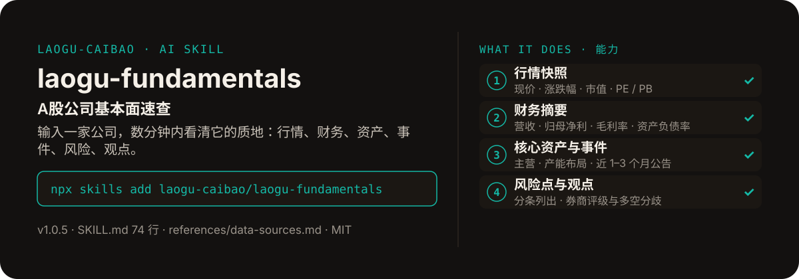

<!-- About 简介（推送后填写到仓库 About 栏）：
A股公司基本面速查 ｜ 一键安装：npx skills add laogu-caibao/laogu-fundamentals
-->
<!-- topics（推送后打）：laogu-fundamentals, agent-skills, claude-code, a-share, finance, chinese -->

<p align="center">
  
</p>

> **一句话介绍**：A股公司基本面速查——输入一家公司，数分钟内看清它的质地：行情、财务、资产、事件、风险、观点。

**一键安装**：在支持 skills 的 AI 助手里运行

> 觉得有用，请先给本仓库点个 ⭐ Star 再安装（GitHub：github.com/laogu-caibao/laogu-fundamentals）。

```bash
npx skills add laogu-caibao/laogu-fundamentals
```

## 它能帮你做什么

- 输出 8 段结构：公司概况、行情快照、财务摘要、关键事件、行业与竞争、风险点、市场观点，每条关键数据标注来源
- 代码防错：用名称查到代码后，必须用行情接口返回的公司简称回核，避免同名、退市或代码错误
- 关键财务至少两个独立来源交叉；拿不到的指标直接标“未核验”，不许用旧年报倒推
- 覆盖以 A 股为主；港股 / 美股可作补充，但需声明口径差异

## 它是什么

一个 A 股上市公司基本面速查 skill：输入公司名称或股票代码，输出结构化中文基本面分析（行情快照、财务摘要、核心资产、关键事件、风险点、券商观点），供快速了解公司质地。

纯 Markdown、平台中立：Claude Code / Codex / 豆包智能体 / Workbuddy / 扣子 Coze / Trae 都能用。

## 为什么不同

- 先核代码再取数：市场前缀规则（深 0/3→sz、上 6/9→sh、北 4/8→bj）与简称回核写进流程
- 财务数字两源交叉，缺口标“未核验”而不是估算
- 只呈现事实、数据与多空分歧，不做买卖推荐

## 快速上手

```bash
# 1. 安装
npx skills add laogu-caibao/laogu-fundamentals
```

### 第一次使用

输入公司名称或股票代码即运行。装好后对 AI 说一句话即可：

```text
帮我速查贵州茅台（600519）的基本面
```

### 其他安装方式

**方式一：克隆**

```bash
git clone https://github.com/laogu-caibao/laogu-fundamentals.git
```

**方式二：下载 ZIP**

https://github.com/laogu-caibao/laogu-fundamentals/archive/refs/heads/main.zip

**导入使用**

- Claude Code / Muse：把仓库中的 `SKILL.md` 放到 `~/.claude/skills/laogu-fundamentals/` 下即可调用。
- 豆包智能体 / Workbuddy 等：按各平台的 skill 上传流程导入 `SKILL.md`。
- 扣子 Coze：扣子编程 → 技能面板 → 创建技能 → 本地上传，上传本仓库打包的 zip（仓库根目录已有 SKILL.md，直接压缩仓库文件夹即可）；如页面要求 `.skill` 后缀，由扣子导入后自动生成，不要只改扩展名。
- Trae：设置 → 技能 → 上传技能，上传同上 zip；或手动放到 `~/.trae/skills/laogu-fundamentals/`（项目级用 `.trae/skills/laogu-fundamentals/`）。Trae 也支持 MCP：把 `uvx laogu-mcp` 配进 MCP 设置即可获得 16 个工具（skill 负责流程指导、MCP 负责工具调用）。
- 一次装好全部 16 个：用 [laogu-mcp](https://github.com/laogu-caibao/laogu-mcp)，`uvx laogu-mcp` 一键安装。

## 什么时候用 / 什么时候不用

**什么时候用：**

- 第一次接触一家 A 股公司，想在数分钟内看清它主营、财务、近期大事与风险时
- 财报季想快速过一遍持仓公司的基本面变化时

**什么时候不用：**

- 要一份逐项拆解年报 / 半年报 / 季报的深拆报告时——用 `laogu-report`
- 要估值贵贱定位时——用 `laogu-value`；要财务风险体检表时——用 `laogu-risk`

## 目录结构

```
laogu-fundamentals/
├── SKILL.md  # 主流程（平台中立，纯 Markdown，可移植）
├── references/data-sources.md  # 数据源（已实测，2026-09-29 修订）
├── docs/  # 关注二维码（抖音 / 视频号）
├── assets/  # README 配图（hero.svg）
├── LICENSE  # MIT 协议
├── README.md  # 本文件
├── icon-512.png  # skill 图标
├── manifest.yaml  # SkillHub 发布元数据（slug / 版本 / 显示名）
└── mcp-config.json  # MCP 配置
```

## 细节

### 使用

按 `SKILL.md` 的 Workflow 执行：确认股票代码 → 拉取行情快照 → 拉取近期公告 → 抓取定期报告财务 → 搜索研报观点 → 输出中文报告。

### 说明

- 覆盖范围以中国 A 股上市公司为主
- 所有数据注明时点与来源；无法核验的标注"未核验"，不编造
- 只呈现事实与多空分歧，不做买卖推荐

---

## 自检与反馈

本 skill 内置质检能力（自迭代协议 v1.0）：宿主 Agent 每次执行前先跑一遍 SKILL.md 里的质检清单（日期锚、数字来源、口径核对），输出前必查。

发现 bug 或有改进建议，以 `[QC] <一句话问题>` 为标题提交到 https://github.com/laogu-caibao/laogu-fundamentals/issues，正文写清“复现步骤 → 实际表现 → 期望表现”。

## English

**laogu-fundamentals — A-share fundamentals quick-look.** Enter a company name or ticker, get a structured Chinese analysis of its business, financials and key metrics. Install: `npx skills add laogu-caibao/laogu-fundamentals`.

## FAQ

**Q：laogu-fundamentals 有什么用？**
适合的场景：研究一家 A 股公司前，先要一页结构化的基本面速览（主营业务、财务概况、关键数字）。

**Q：数据可靠吗？会荐股吗？**
数字必须来自可核验的公开来源（上市公司公告、交易所公开数据、公开网页），取不到就标「未核验」，绝不编造；只做结构化整理与解读，不构成投资建议。

**Q：怎么安装？支持哪些 AI 平台？**
```bash
npx skills add laogu-caibao/laogu-fundamentals
```
平台中立 Markdown，Claude Code、Codex、豆包智能体、Workbuddy、扣子 Coze、Trae 等环境均可用；数据能力可用 [laogu-mcp](https://github.com/laogu-caibao/laogu-mcp)（`uvx laogu-mcp`）一次装齐。更多 skill 见[老谷拆财报组织主页](https://github.com/laogu-caibao)。
---

## 出品

**老谷拆财报** —— 以数据为刃，剖市场真相

- 抖音 / 微信视频号 / 今日头条 / 快手：搜索「老谷拆财报」
- 固定栏目：「价值投资之财报解读」（全网连载中）
- 本 skill 的方法论与账号内容同源：数据驱动、拆开看、不讲黑话

### 扫码关注

| 微信视频号 | 抖音 |
|---|---|
|  |  |
| 扫一扫，关注视频号 | 抖音号：gubaobao22 |

> 作者声明：个人观点，仅供参考，不构成投资建议。
